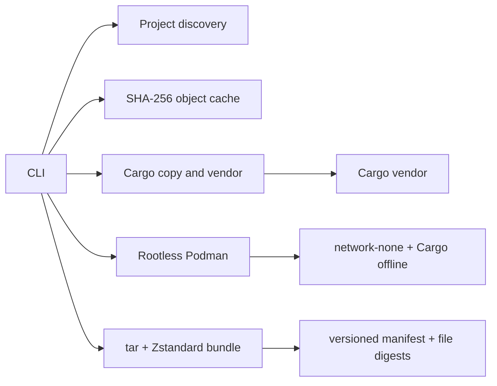

<p align="center">
  
</p>

<h1 align="center">BLACKOUT</h1>
<p align="center"><strong>Disconnect the world. Keep building.</strong></p>

BLACKOUT is a local-first Linux CLI for inspecting projects, caching verified files, preparing Cargo dependencies, and creating portable source bundles. It can also check Podman's network isolation and run a prepared Cargo build or test in a rootless, network-disabled container.

> **Status: early development (0.1.0).** The Rust/Cargo path is the only preparation and validation backend. Python, Node.js, and Go are detected for inventory only. This release does not claim reproducible binaries, universal host isolation, or production hardening.

## What works today

- Scan a directory for Cargo, Python, Node.js, and Go markers without following symbolic links.
- Copy a locked Cargo project into a new directory and vendor its dependencies without changing the source tree or running build scripts.
- Check Podman's `--network=none` behavior with a real TCP attempt to a host-loopback listener.
- Run Cargo build or tests for a prepared project with `--offline` inside a rootless, resource-limited Podman container.
- Store a file in a local SHA-256 content-addressed cache and verify it later.
- Create and verify `tar.zst` source bundles; restore verified files into a new directory with path, file-type, duplicate, size, and checksum checks.
- Generate Markdown or JSON reports from project discovery and the last observed validation results.
- Check the locked dependency graph for advisories, licenses, duplicate packages, and unapproved sources with `cargo-deny` in CI.
- Omit common secret files and generated directories from prepared copies and bundles.

The bundle contains the prepared source and Cargo vendor tree when the input is prepared. It does not contain a compiler/container image, system libraries, or a guarantee that the target machine has a compatible toolchain.

Example result from the controlled offline integration fixture:

```json
{
  "action": "build",
  "passed": true,
  "network_isolated": true,
  "image": "docker.io/library/rust@sha256:3490aa77d179a59d67e94239cca96dd84030b564470859200f535b942bdffedf"
}
```

The committed fixture and workflow exercise this path; the printed image digest in a run is the value selected by the operator or CI configuration.

## Install

### Download the Linux x86_64 binary

The [v0.1.0 release](https://github.com/root465-lipcripto/blackout/releases/tag/v0.1.0) includes a prebuilt Linux x86_64 GNU/Linux archive. It requires glibc 2.34 or newer. Verify the checksum file from the same release before installing:

```sh
curl -LO https://github.com/root465-lipcripto/blackout/releases/download/v0.1.0/blackout-x86_64-unknown-linux-gnu.tar.gz
curl -LO https://github.com/root465-lipcripto/blackout/releases/download/v0.1.0/SHA256SUMS.txt
grep 'blackout-x86_64-unknown-linux-gnu.tar.gz' SHA256SUMS.txt | sha256sum --check
tar -xzf blackout-x86_64-unknown-linux-gnu.tar.gz
install -Dm755 blackout-x86_64-unknown-linux-gnu/blackout "$HOME/.local/bin/blackout"
blackout --version
```

The archive contains the executable, this README, and the GPL-3.0-only license. The release does not currently include ARM64 or other operating-system binaries.

### Build from source

Building from a checkout requires Rust and Cargo 1.85 or newer:

```sh
cargo install --path . --locked
```

### Offline validation requirements

Podman is required for the network isolation check and isolated Cargo validation. A locally available container image is also required for the selected task. The default validation image is `rust:1.85-slim`; BLACKOUT never pulls an image automatically.

`blackout doctor` reports whether Podman is available and configured rootless. The network probe uses `registry.fedoraproject.org/fedora:latest` by default; set `BLACKOUT_PROBE_IMAGE` to another already-present image with a compatible libc when needed. Build/test validation uses `BLACKOUT_SANDBOX_IMAGE` and defaults to `rust:1.85-slim`. CI pins both container images by digest.

## Quick start

```sh
# Inspect the project. JSON is suitable for scripts.
blackout scan . --json

# Prepare into a separate directory. Requires Cargo.lock and Cargo.
blackout prepare ./my-project --output /mnt/usb/my-project-offline

# Demonstrate that a container cannot connect to a local host listener.
blackout sandbox-check

# Build or test the prepared copy. Both execute project code in Podman.
BLACKOUT_SANDBOX_IMAGE=rust:1.85-slim blackout validate build /mnt/usb/my-project-offline
BLACKOUT_SANDBOX_IMAGE=rust:1.85-slim blackout validate test /mnt/usb/my-project-offline

# Package the prepared copy, verify it, and restore to a fresh directory.
blackout bundle create /mnt/usb/my-project-offline --output /mnt/usb/my-project.blackout
blackout bundle verify /mnt/usb/my-project.blackout
blackout restore /mnt/usb/my-project.blackout /tmp/my-project-restored
blackout report /tmp/my-project-restored --json
```

Images must be pulled and reviewed before the offline workflow. BLACKOUT uses `--pull=never`, so a missing image fails instead of being downloaded. For example, while online, an operator can pull the pinned image they have chosen, inspect it, then disconnect before validation.

## Other commands

```sh
blackout --help
blackout doctor --json
blackout scan ./repo
blackout cache put ./artifact.tar.zst
blackout cache verify <64-character-sha256>
blackout cache status
```

The cache lives under `$XDG_CACHE_HOME/blackout/objects` (or `$HOME/.cache/blackout/objects`). Objects are stored by SHA-256. BLACKOUT does not delete original package-manager caches. Cache garbage collection and cache metadata/reference tracking are not implemented yet.

## Bundle format

A `.blackout` bundle is a Zstandard-compressed tar archive. It contains `BLACKOUT-MANIFEST.json` and regular source files. The versioned manifest records the project name, detected ecosystem, host target, and SHA-256, size, and safe permission bits for each file. Validation values remain `null` because a bundle operation alone does not perform a build or test.

Extraction refuses absolute or parent-traversal paths, links, devices, duplicate entries, unlisted files, oversized files/bundles, invalid hashes, and existing destinations. Common `.env`, key, certificate, `target/`, `.git/`, virtualenv, and `node_modules/` content is omitted. This filter is not a semantic secret scanner; review a bundle before transporting it.

Checksums detect accidental or malicious changes only when the manifest is trusted. They do not authenticate the author or protect against an attacker who can replace both the manifest and bundle.

## Architecture



The first implementation is a single crate with module boundaries for discovery, cache, bundle, and sandbox operations. Separate adapter crates will be useful once multiple ecosystems have complete, tested workflows; empty crates are deliberately not included.

## Ecosystem support

| Ecosystem | Detection | Prepare | Offline build/test | Bundle/restore |
|---|---:|---:|---:|---:|
| Cargo | Yes | Yes, with `Cargo.lock` | Yes, via Podman and local image | Yes |
| Python | Yes | No | No | Source files only |
| Node.js | Yes | No | No | Source files only |
| Go | Yes | No | No | Source files only |

Cargo projects with an existing `.cargo/config.toml` are currently rejected by `prepare`; combine the project configuration with Cargo's vendor configuration manually before retrying. Cross-compilation and workspace combinations with uncommon source overrides require more integration coverage.

## Security model and limitations

BLACKOUT avoids privileged containers, host home mounts, SSH agents, and host sockets. Validation sets `--network=none`, uses a read-only container root, drops capabilities, keeps the caller's user namespace, applies CPU/memory/process limits, and mounts only the prepared project as writable. The container image is selected locally and is never pulled by BLACKOUT.

Containers reduce exposure; they are not a proof against kernel vulnerabilities or malicious container runtimes. Validation executes build scripts and tests from the prepared project. Review third-party source and the chosen image before running it. A project build may modify its prepared copy, including its `target/` directory.

See [the threat model](docs/threat-model.md), [limitations](docs/limitations.md), and [bundle format](docs/bundle-format.md).

## Research and related tools

Cargo vendoring, Go vendor mode, pip's local `--no-index` installs, and npm's offline mode each cover parts of offline dependency use. They do not by themselves prove a build process cannot reach the network. Podman's `--network=none` provides the isolation mechanism used here. Nix and Bazel address broader hermetic/reproducible build problems; BLACKOUT is currently much smaller and does not replace them.

The name BLACKOUT is used by unrelated public projects. This repository makes no claim of name uniqueness; its subtitle and owner distinguish this specific tool. More detail and source links are in [docs/research.md](docs/research.md).

## Roadmap

- **0.1.x:** strengthen Cargo compatibility, bundle security fixtures, and isolation CI; improve reports and cache metadata.
- **0.2:** add a complete Python adapter if lockfile and wheelhouse workflows can be validated offline.
- **0.3:** add Go and Node.js only after dependency closure and offline execution are tested; add portable machine-readable reports.
- **Later:** multi-architecture validation, signed attestations, storage references/GC, and package formats.

The v0.1.0 release provides one Linux x86_64 GNU/Linux binary. It does not claim ARM64 support, reproducible binaries, or other operating-system artifacts.

## Contributing

Read [CONTRIBUTING.md](CONTRIBUTING.md) before opening a change. Security issues should be reported privately as described in [SECURITY.md](SECURITY.md).

## License

GPL-3.0-only. See [LICENSE](LICENSE).
